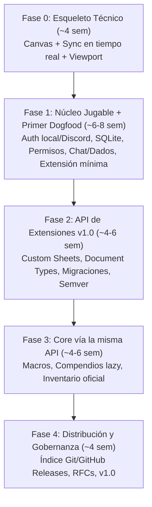

# RollForge VTT — Plan de Implementación Paso a Paso

*Actualizado: 26 sept 2026. Totalmente alineado con el Documento de Diseño (`sistema.md`).*

---

## 1. Stack Tecnológico Consolidado

| Capa / Componente | Tecnología | Justificación según `sistema.md` |
| --- | --- | --- |
| **Lenguaje** | TypeScript (strict) | Tipos compartidos server/client/protocol/extension-api; sostiene contrato semver (§13, §14) |
| **Monorepo** | pnpm workspaces + `catalog:` | Gestión centralizada de dependencias compartidas sin duplicar ni provocar drift (§3, §14) |
| **Servidor HTTP / Auth** | Node.js 20+ con Express | LTS, soporte para `--experimental-permission`, API REST y servicio de estáticos (§4, §14) |
| **Red / Tiempo Real** | Socket.io | *Rooms* nativas para suscripción por escena (§10, §14) sin construirlo a mano |
| **Persistencia** | `better-sqlite3` (patrón Repository) | Base de datos embebida; un archivo SQLite por campaña/mundo, portable y sin infra externa (§14) |
| **Renderizado Canvas** | PixiJS 8+ con **`pixi-viewport`** | Aceleración 2D WebGL/WebGPU; gestión madura de cámara (pan/zoom/límites) sin reinventarla (§14) |
| **UI & Fichas** | Preact + **`@preact/signals`** | Reactividad granular: mutaciones de socket actualizan signals directas sin re-renderizar todo (§14) |
| **Bundler** | Vite + `@preact/preset-vite` | HMR ultra-rápido y compilación TS nativa para core y extensiones cliente |
| **Testing** | Vitest | Mismo motor que Vite, runner unificado para core y el kit de testing de extensiones (`api.testing`) |
| **Autenticación** | Cuenta local (**argon2id**, sin email) + Discord OAuth (opcional con dominio/túnel fijo) | Cuenta local sin fricción ni servidor SMTP como camino por defecto (primer arranque y LAN). Discord OAuth requiere redirect URI https fija. Reseteo por GM y rate limiting básico (§14) |
| **Túneles NAT (Opcional)** | Cloudflare Tunnel (nombre fijo) / Tailscale Funnel | Guías/scripts para jugar sin abrir puertos ni montar relays propietarios; soporte de túnel rápido para partidas directas (§14) |

---

## 2. Estructura del Monorepo

```
Rollforge/
├── package.json              (workspace root: scripts, devTools, catalog)
├── pnpm-workspace.yaml       (packages: ['packages/*'])
├── tsconfig.base.json        (configuración base TS: strict, composite, paths)
└── packages/
    ├── protocol/             (@rollforge/protocol)
    │   ├── package.json
    │   ├── tsconfig.json
    │   └── src/
    │       ├── documents.ts  (Document, Actor, Item, Scene, OwnershipLevel)
    │       ├── messages.ts   (Payloads socket: intenciones, diffs, locks efímeros)
    │       ├── hooks.ts      (Definición de nombres y payloads de hooks de notificación y filtro)
    │       ├── manifest.ts   (Esquema TypeScript de extension.json y contributes)
    │       └── index.ts
    ├── extension-api/        (@rollforge/extension-api)
    │   ├── package.json      (SDK y tipos públicos congelados para autores de extensiones)
    │   ├── tsconfig.json
    │   └── src/
    │       ├── server.ts     (ServerExtensionAPI, ServerExtensionContext)
    │       ├── client.ts     (ClientExtensionAPI, ClientExtensionContext)
    │       ├── testing.ts    (Helpers de testing como runMigration)
    │       └── index.ts
    ├── server/               (@rollforge/server)
    │   ├── package.json
    │   ├── tsconfig.json
    │   └── src/
    │       ├── main.ts
    │       ├── auth/         (Cuentas locales argon2id + rate limiter + Discord OAuth opcional + JWT)
    │       ├── db/           (better-sqlite3 + DocumentStore con patrón Repository)
    │       ├── sync/         (Socket.io rooms por escena + locks efímeros de arrastre)
    │       ├── security/     (authorize() centralizado para intenciones y mutaciones)
    │       ├── extensions/   (Loader, lifecycle, hooks engine, migration runner)
    │       └── scenes/       (Gestor de estado autoritativo de escenas)
    └── client/               (@rollforge/client)
        ├── package.json
        ├── tsconfig.json
        ├── index.html
        ├── vite.config.ts
        └── src/
            ├── main.ts
            ├── canvas/       (PixiJS Application + pixi-viewport + grid + token rendering)
            ├── net/          (Socket.io client + reconexión + diff patching con _rev)
            ├── state/        (Signals para estado de documentos y escena activa)
            ├── extensions/   (Client extension loader + registro de custom sheets y UI)
            └── ui/           (Preact components: Login, Toolbar, SceneNav, Chat, GM Panel)
```

---

## 3. Plan de Fases Detallado



---

### Fase 0 — Esqueleto Técnico (\~4 semanas)

> **Hito de salida / Checkpoint (§15):** Dos navegadores distintos en máquinas o pestañas separadas ven el mismo token moverse en tiempo real sin desincronización ni parpadeos.

#### Paso 1: Inicialización del Monorepo

- Configurar `package.json` raíz privado y `pnpm-workspace.yaml`.
- Configurar `tsconfig.base.json` (strict, target ES2022, moduleResolution bundler/NodeNext).
- Crear los paquetes: `packages/protocol`, `packages/extension-api`, `packages/server`, `packages/client`.
- Añadir scripts raíz: `pnpm dev`, `pnpm build`, `pnpm test`, `pnpm lint`.
- **Verificación:** `pnpm install && pnpm build` ejecuta en limpio para todos los workspaces.

#### Paso 2: Definición del Protocolo Base (`@rollforge/protocol`)

- Definir estructura universal de `Document` (§5):

  ```ts
  interface Document<TSystem = Record<string, unknown>> {
    id: string;
    type: string;
    name: string;
    img?: string;
    system: TSystem; // Sin tipar por el core
    flags: Record<string, Record<string, unknown>>; // Namespaced por id de extensión
    ownership: Record<string, OwnershipLevel> & { default?: OwnershipLevel };
    _rev: number; // Para control de versiones y diffs
  }
  ```
- Definir `OwnershipLevel`: `"NONE" | "LIMITED" | "OBSERVER" | "OWNER"`.
- Definir payloads de Socket.io:
  - Intenciones: `MoveTokenIntent`, `AcquireDragLockIntent`, `ReleaseDragLockIntent`.
  - Diffs/Eventos: `TokenPositionDiff`, `DragLockAcquiredEvent`, `DragLockReleasedEvent`.
- **Verificación:** Tests con Vitest para serialización y validación de tipos.

#### Paso 3: Servidor de Sincronización Mínimo

- Servidor HTTP con Express para servir la app cliente.
- Instancia de Socket.io con rooms por `sceneId`.
- Estado autoritativo en memoria para tokens de escena (`x`, `y`, `tokenId`, `_rev`).
- **Manejo de concurrencia y Lock Efímero (§10):**
  - La primera intención de arrastre sobre `tokenId` adquiere un lock transitorio en memoria.
  - El servidor ignora intenciones de arrastre concurrentes de otros usuarios sobre ese token.
  - Auto-liberación por evento `drop`/`mouseup` o timeout de seguridad (\~5s por si el cliente se desconecta).
- Broadcast de posiciones efímeras throttled (\~15-20 Hz) a los clientes suscritos a la room.
- **Verificación:** Conectar dos sockets de test, simular arrastre concurrente y verificar que el lock protege la propiedad del arrastre.

#### Paso 4: Canvas con PixiJS y `pixi-viewport`

- Inicializar `pixi.js` con WebGL/WebGPU en `@rollforge/client`.
- Integrar `pixi-viewport` para soporte nativo de:
  - Pan (arrastrar con botón derecho o rueda).
  - Zoom (rueda del ratón hacia el puntero con límites min/max).
- Capa de Grid cuadrado/hexagonal renderizado de forma eficiente.
- Capa de Tokens interactivos:
  - Drag & drop suave con puntero.
  - Durante el arrastre: emitir coordenadas efímeras throttled a \~15-20 Hz.
  - Al soltar (`pointerup`): emitir la intención de posición final persistente.
  - Renderizado interpolado de tokens movidos por otros usuarios.
- **Verificación:** El canvas responde a pan/zoom y los tokens se arrastran suavemente sin jitter.

#### Paso 5: UI Shell y Reactividad con `@preact/signals`

- Montar shell con Preact en un overlay HTML sobre el canvas de PixiJS.
- Vincular el estado de los tokens a signals (`@preact/signals`).
- Barra de herramientas mínima: selector de escena y botón para crear token placeholder.
- **Verificación:** Modificar una signal actualiza únicamente el componente UI afectado sin re-renderizar todo el árbol.

#### Paso 6: Integración y Demo Fase 0

- Script `pnpm dev` que arranca servidor y cliente con Vite HMR.
- Abrir dos pestañas en paralelo.
- Mover token en una pestaña → se refleja en tiempo real en la otra con lock visual de arrastre.
- **Verificación:** Checkpoint de Fase 0 superado exitosamente.

---

### Fase 1 — Núcleo Jugable + Primer Dogfood (\~6-8 semanas)

> **Estado: completada.** Pasos 7–12 implementados y verificados. Desviaciones documentadas al final de la sección.

> **Objetivo:** Campañas persistentes, autenticación, autorización estricta, chat, dados y primer dogfooding de la API de extensiones.

#### Paso 7: Persistencia con `better-sqlite3` (`DocumentStore`)

- Implementar el patrón Repository encapsulado en `DocumentStore` (§14):
  - Esquema SQLite: tablas `documents` (`id`, `type`, `data` JSON, `_rev`, `updated_at`), `scenes`, `users`.
  - Un archivo SQLite por campaña/mundo (`<data>/worlds/<world-id>/world.db`).
  - Métodos CRUD con transacciones atómicas de SQLite: `getById`, `getByType`, `save`, `update`, `delete`.
- Versionado optimista: incrementar `_rev` en cada mutación atómica.
- **Migración del esquema propio del core** (distinta de la de extensiones en §12/Paso 15 — esta es la de las tablas `documents`/`scenes`/`sessions` en sí): tabla `_meta` con `coreSchemaVersion`; al arrancar, el servidor corre un runner de migración incremental `N -> N+1` sobre el archivo SQLite del mundo antes de aceptar tráfico, mismo criterio sin down-migrations que el resto del documento. Sin esto, un mundo con datos reales no tiene vía de actualizar su archivo cuando el core añada una columna en una versión futura.
- **Verificación:** Crear tokens/documentos, reiniciar el servidor Node y constatar recuperación idéntica del estado. Un mundo con `coreSchemaVersion` antiguo se migra automáticamente al arrancar sin intervención manual.

#### Paso 8: Autenticación (Cuenta Local como Camino por Defecto + Discord OAuth Opcional) (§14)

- **Cuentas locales (camino por defecto, sin fricción):**
  - Creación directa de cuentas por el usuario/jugador **sin confirmación de email** (evita dependencia de servicios SMTP externos).
  - Hash de contraseñas robusto con **`argon2id`** (estándar OWASP).
  - Rate limiting básico en el endpoint de login (ej. 5 intentos fallidos → bloqueo de 60s) como protección contra fuerza bruta.
  - Gestión y reseteo de contraseñas olvidadas directamente por el GM desde su panel de control.
- **Discord OAuth (opcional para instalaciones expuestas):**
  - Soporte de OAuth2 para servidores con dominio propio o túnel con nombre fijo HTTPS (el GM registra su propia Discord Application).
- **Sesión opaca, no JWT** (coherente con §14: un JWT autocontenido exige lista de bloqueo para revocar antes de expirar, justo la complejidad que se evitaba): id de sesión aleatorio en cookie `httpOnly` firmada, referenciando una fila en tabla `sessions` de la misma SQLite del mundo (`id`, `userId`, `createdAt`, `expiresAt`). Revocar = borrar la fila.
- Handshake de Socket.io autenticado extrayendo el `userId` y rol consultando la tabla `sessions` a partir del id de la cookie.
- Roles de usuario: `GM` (Game Master) y `Player`.
- **Verificación:** Creación y login de cuenta local con argon2id funcional sin requerir SMTP; rate limiting bloquea tras 5 intentos erróneos; GM puede resetear contraseñas de jugadores.

#### Paso 9: Autorización Centralizada (`authorize()`)

- Implementar la función pura de autorización (§9):

  ```ts
  function authorize(userId: string, action: ActionType, doc: Document, isGM: boolean): boolean {
    if (isGM) return true;
    const level = doc.ownership[userId] ?? doc.ownership.default ?? "NONE";
    return levelSatisfies(level, requiredLevelFor(action));
  }
  ```
- Pipeline server autoritativo (§10): `Cliente → authorize() → Aplicar & _rev++ → DocumentStore → Broadcast diff`.
- El cliente nunca muta estado directamente; sólo emite intenciones.
- **Verificación:** Un usuario `Player` sin permisos de ownership no puede mover ni editar un token/actor ajeno.

#### Paso 10: Gestión de Escenas y Campañas

- CRUD completo de escenas (dimensiones, imagen de fondo, tamaño de grid, color).
- **Cámara del GM**: server mantiene `activeSceneId` autoritativo. Solo el GM puede cambiarlo (`SetActiveScene` intent, gate por `role === "GM"`). Cambio emite `ActiveSceneChanged` a todos.
- Players auto-join a `scene:<activeSceneId>` al conectar y en cada cambio; nunca navegan libres. Toolbar muestra el scene-id read-only para players.
- **GM con dos escenas**: `activeSceneId` (lo que ven los players) y `gmViewSceneId` (lo que el GM está mirando/editando). Por defecto `gmViewSceneId === activeSceneId`; el GM puede fijar `gmViewSceneId` a cualquier escena para previsualizar/editarla sin mover a los players. Los intents del GM (click, drag, MoveToken) operan sobre `gmViewSceneId`.
- Gate en server: cualquier intent de un Player cuya `sceneId` no coincida con `activeSceneId` se rechaza con `reason: "not-in-active-scene"`.
- Suscripción dinámica de Socket.io: `scene:<id>` room por escena activa.
- **CRUD escenas (Phase 2, shipped)**: `CreateScene`/`UpdateScene`/`DeleteScene` intents, GM-only; broadcast `SceneCreated`/`SceneUpdated`/`SceneDeleted`. Server auto-siembra escena `default` con `4000×4000`, grid 50px, color `0x2c313a`. Persistencia vía `DocumentStore` (tipo `Scene`). Si se borra la escena activa → fallback a `default` + broadcast `ActiveSceneChanged`. Cliente: `scenes` signal + `activeScene` computed; Toolbar usa dropdown de escenas (GM); GmPanel tiene sección "Scenes" con list/edit/create/delete.
- **Reactividad grid**: `cellSize` signal sincronizado desde `activeScene.system.grid.size`; el grid y el viewport se redibujan/redimensionan cuando la escena activa cambia.
- **Map upload**: `POST /api/uploads` (GM-only, base64-in-JSON para evitar multer). Guarda en `data/uploads/<hash>.<ext>`, sirve vía `express.static("/uploads")`. Permite PNG/JPG/GIF/WEBP ≤10MB. Vite proxy `/uploads → :3000` para dev. `SceneEditForm` tiene file picker que sube y rellena el campo `background` con la URL retornada.
- **Alineación imagen↔grid**: lazy by design — imagen en world (0,0) a tamaño nativo, grid en world (0,0) con `grid.size` incrementos; ambos comparten origen y 1px = 1 unidad, así que coinciden automáticamente cuando el GM pone el `grid.size` correcto. El cliente no necesita lógica de "snap"; renderiza Sprite a tamaño nativo y deja que el GM ajuste el grid al mapa.
- **Verificación:** Cambiar de escena sólo transmite eventos y diffs a los usuarios presentes en dicha escena; un Player que intenta `SetActiveScene` recibe `intentRejected.reason: "forbidden"`; un Player que se conecta aterriza en la escena activa, no en "default"; el GM puede `MoveToken` en una escena distinta a `activeSceneId` sin que los players se enteren (porque no están suscritos a esa room); crear/editar/borrar una escena actualiza el dropdown de todos los clientes; borrar la escena activa cae a `default`.

#### Paso 11: Motor de Dados y Chat Básico

- Parser y evaluador de dados en `@rollforge/protocol`:
  - Notaciones estándar: `NdX+K`, `1d20kh1`, `4dF`, `d100`.
  - Generador de resultados con desglose de tirada individual.
- Panel de chat en Preact:
  - Mensajes públicos y whispers privados (`/w <usuario>`).
  - Mensajes del sistema y tiradas de dados (`/roll 2d6+3`).
  - Persistencia de mensajes en la base de datos de la campaña.
- **Verificación:** Tiradas evaluadas correctamente con desglose visible en el chat y guardadas en SQLite.

#### Paso 12: Arquitectura Mínima de Extensiones y Primer Dogfood (§3, §6, §7)

- Definir el manifiesto `extension.json`:
  - `id`, `version`, `engines.core` (semver), `activationEvents` (sin comodín `*`), `contributes`.
  - Puntos de entrada separados: `main.server` y `main.client` (§6).
- Motor de Hooks en Server y Client (§7):
  - **Notificación** (`api.hooks.on(event, payload => ...)`): async/sync, sin retorno.
  - **Filtro** (`api.hooks.filter(event, data => modifiedData, { priority })`): cadena secuencial con prioridad.
- Ciclo de vida básico: máquina de estados (`Discovered → Validated → Registered → Active → Inactive`) con try/catch y timeout (§8).
- **Dogfood obligatorio (§3):**
  - Implementar los comandos de chat (`/roll`, `/w`) y modificadores de dados pasando **a través del sistema de hooks/contributes**, no como código cableado a fuego dentro del core.
- **Verificación:** Una extensión interna registra `/roll` mediante `contributes.chatCommands` y modifica tiradas con `hooks.filter("preDiceRoll")`.

#### Desviaciones de Fase 1 (decisiones tomadas al implementar)

1. **Carga de extensiones en disco** — `extensions/loader.ts` descubre `<dataDir>/extensions/<id>/extension.json` e importa `main.server` (ESM plano) con `pathToFileURL`. Un `pathToFileURL` no es opcional: en Windows un path con `\` no es un specifier válido para `import()`. La carga es *fault-tolerant por extensión* e idempotente, y ocurre **antes** del primer `dispatchActivationEvent("onReady")`; registrar después haría invisible para siempre a una extensión `onReady`.
2. **Host de extensiones en cliente: aplazado a Fase 2 (Paso 13/14)** — cargar JS de disco en el navegador exige bundling, fetching de manifiestos y un manager espejo. `extension-api/src/client.ts` sigue siendo solo tipos. Se construye cuando las custom sheets lo necesiten de verdad, no antes.
3. **Sesiones opacas sin firma y en su propia base de datos** — la cookie `rf_session` lleva un id aleatorio de 256 bits, no un JWT. Revocar es un `DELETE`, que es el objetivo de §14. Dos desviaciones respecto al texto original: (a) la tabla `sessions` va en `data/sessions.db`, no en la SQLite del mundo, porque `users` ya es global a la instalación y meter sesiones por mundo dejaría un estado híbrido sin caso de uso; (b) la cookie no va firmada, porque la firma no protege nada aquí — el rol nunca viaja en la cookie y 256 bits de `randomBytes` no son adivinables. El rol se resuelve **vivo** contra `users` en cada request, así que un cambio de rol aplica sin re-login.
4. **Discord OAuth pendiente** — marcado como opcional desde el principio; no implementado.
5. **Parser de dados movido a `@rollforge/protocol`** — `parseDiceTerms` / `validateDice` / `DICE_LIMITS` viven en el paquete de tipos porque el cliente los necesita para previsualizar y las extensiones de Fase 2 los exponen vía `api.dice`. Solo el *rodaje* sigue en el server, que necesita la librería y el RNG criptográfico.

---

### Fase 2 — API de Extensiones v1.0 & Custom Sheets (\~4-6 semanas)

> **Objetivo:** Generalizar y estabilizar el sistema de extensiones, contribution points completos, renderizadores de fichas, migraciones de datos y congelar el contrato semver (§13).

#### Paso 13: Contribution Points Completos

- Implementar procesamiento declarativo de `contributes` sin ejecutar código de la extensión:
  - `contributes.documentTypes`: Definición de nuevos tipos (ej. `cpr-character`, base `Actor`, `schemaVersion`).
  - `contributes.sheets`: Registro de componentes Preact para renderizar fichas custom.
  - `contributes.chatCommands`: Comandos con permisos requeridos y activación lazy.
- Registro defensivo en el core: seguimiento de todo lo que cada extensión registra para limpieza atómica al desactivarse (§8).
- **Verificación:** Desactivar una extensión retira automáticamente sus tipos, hooks y comandos sin dejar basura en memoria.

#### Paso 14: Renderizado de Fichas Dinámicas (Custom Sheets)

- Exponer API cliente para registro de fichas personalizadas:

  ```ts
  clientApi.ui.registerSheet({
    documentType: "cpr-character",
    component: CPRCharacterSheetComponent,
    default: true
  });
  ```
- Integrar primitivas de UI para formularios (§16):
  - Inputs vinculados a rutas del esquema (`system.stats.hp.value`) con debounce automático hacia el servidor.
  - Acceso a `system` y `flags` mediante Signals reactivas.
- **Verificación:** La ficha custom de un Actor se abre, renderiza datos del `system` y sincroniza ediciones bidireccionalmente.

#### Paso 15: Motor de Migraciones de Esquema (`schemaVersion`) (§12)

- Modelo de migraciones:
  - `schemaVersion` entero independiente de la versión semver del paquete.
  - Cadenas incrementales `N -> N+1` con snapshot previo en SQLite (sin down-migrations).
  - Confirmación tras cada paso individual en la base de datos.
- Estrategias de ejecución:
  - **Eager:** Documentos de campaña al activar la extensión. Se ejecuta dentro de `doActivate`, después de que `ext.entry.activate(api)` haya llamado a `api.documents.registerMigrations(...)`.
  - **Lazy con Lock Efímero:** Entradas de compendio al abrirse; un mutex en memoria (`MigrationLock` keyed por `documentType`) evita que dos usuarios migren el mismo compendio simultáneamente (§12).
- **Radio de fallo por documento, no por extensión:** una migración fallida marca el documento (`migration_status='blocked'` + snapshot en `document_migration_snapshots`) y la extensión sigue `Active` con el resto de documentos migrados con normalidad. Solo `activate()` lanzando o una cadena mal declarada escalan a `Errored`. La asimetría es deliberada y opuesta a §12 (versión más nueva bloquea edición de ese doc); en ambos casos el blast radius es el documento, no la extensión.
- **Gate durante el arranque:** entre `registerExtension` (el manifest declara `contributes.documentTypes`) y la migración eager (que termina cuando `doActivate` finaliza), el documento está registrado pero no migrado. Las escrituras a ese `documentType` se rechazan con `extension-not-ready` (HTTP 503 / `DocumentGateError`) hasta que la extensión llegue a `Active`. Reads pasan; el cliente puede seguir viendo la lista.
- **schemaVersion al crear:** los documentos nuevos se crean al `schemaVersion` actual del `DocumentTypeRegistry` (vía callback `getCurrentSchemaVersion` en `DocumentStore`). El `0` por defecto queda reservado para filas pre-columna; un documento nuevo de una extensión con `schemaVersion: 3` ya nace en v3, no entra a la cola 0→1→2→3.
- **Re-activation retry:** al reactivar una extensión (`retryExtension` o swap manual), el loop eager vuelve a listar documentos con `schemaVersion < target` sin mirar `migration_status`. Un doc previamente bloqueado se reintenta solo; si la cadena está corregida, migra y limpia el flag. Si falla igual, queda bloqueado otra vez con un snapshot nuevo. Intencional: si el bug se arregló en una versión posterior, la recuperación no debería requerir `/migrations retry` manual.
- **Sin down-migrations (explícito):** no se exponen funciones inversas en la API ni en el runner.
- Proporcionar helper de testing: `runMigration(fn, input)` y `runChain(chain, input, fromVersion, targetVersion)` exportados de `@rollforge/extension-api/testing`. **No** forman parte del API congelada — son helper de autor, importado directo en `.test.ts`. Mismo criterio que el caso de `chatCommands` movido a `contributes`: el helper de testing no debe entrar bajo el contrato semver de §13.
- Comando admin: `/migrations list` (muestra documentos bloqueados), `/migrations retry <docId>` (re-corre la cadena) y `/migrations review <docId> <skipList> <systemJson>` (recovery del GM: sustituye el resultado del paso roto y la cadena sigue desde ahí). Implementado como **builtin** (`packages/server/src/extensions/builtins/migrations.ts`) que consume una superficie angosta `api.migrations: { listBlocked, retry, review }` expuesta por el host — NO como comando de host directo. La regla de lint de `extensions/builtins/**` (Paso 12, `eslint.config.js`) prohíbe imports relativos y `node:*`, lo que obliga a este camino: la única forma de tocar DB/registry desde un builtin es a través de la API congelada. El host implementa esa API en `ExtensionManager.createScopedAPI` (`packages/server/src/extensions/manager.ts`) usando el `MigrationRegistry`, `MigrationLock` y `getDocumentDb`/`getDocumentStore` que ya tenía cableados. Permisos `GM` (protección por `requiredPermission` + rechazo de duplicados del registry). Prefijo `/` igual que el resto de comandos de chat (`/w`); la diferenciación "admin vs user" la da `requiredPermission`, no un prefijo distinto.
- **Regression guard:** `packages/server/src/extensions/lint.adminCommand.test.ts` recorre `packages/server/src/**.ts` y falla si algún archivo fuera de `extensions/builtins/` (o `extensions/manager.ts`) llama a `commandRegistry.register(` directamente. La regla de lint del Paso 12 cubre el camino "builtins no importan host"; este test cubre el camino inverso "host no registra comandos por su cuenta". Si alguien reviviese `db/migrationsCommand.ts` u otro host-utility, este test lo caza antes de que llegue a code review.
- **Verificación:** Documento con `schemaVersion: 1` se migra a `schemaVersion: 3` a través de los pasos 1->2 y 2->3 conservando integridad; doc con bug en el paso 1→2 queda `migration_status='blocked'` con snapshot, la extensión sigue `Active`, los otros docs del mismo tipo que sí migran quedan bien; `/migrations retry` sobre el doc bloqueado después de corregir la cadena termina con `migration_status='ok'`; `/migrations review <docId> 1 '{"hp":7}'` salta el paso roto con un systemOverride y la cadena continúa desde el v2 (9 tests en `packages/server/src/extensions/builtins/migrations.test.ts`).

#### Paso 16: Contrato Semver y Congelación de la API Pública (`@rollforge/extension-api`) (§13)

- Congelar formalmente las interfaces públicas de `ServerExtensionAPI` y `ClientExtensionAPI`:
  - `api.documents`: `get`, `create`, `update`, `delete`, `registerMigrations` (Paso 15).
  - `api.hooks`: `on`, `filter`, `off`.
  - `api.chat`, `api.dice`, `api.ui`.
- **Helpers de testing NO forman parte del API congelada.** `runMigration` y `runChain` viven en `@rollforge/extension-api/testing` como exports directos del paquete. Una extensión los importa en sus archivos `.test.ts`. Esto sigue el mismo criterio que `chatCommands` movido a `contributes`: lo que es solo-para-test no debe entrar bajo el contrato semver del API. Si en el futuro se decide exponer un `api.testing` runtime, será una adición explícita con su propia línea en este contrato.
- Prevenir acceso a internals: **`Object.freeze` recursivo/profundo**, no superficial — `Object.freeze` de un solo nivel no congela objetos anidados (`api.documents`, `api.hooks` seguirían siendo mutables). Aplicar la congelación a cada objeto anidado del árbol de `api`, o documentar explícitamente que la garantía real es el tipado de TypeScript y el freeze en runtime es defensa adicional, no la protección en sí. No exponer clases internas del canvas o DB (§4).
- Validar `engines.core` contra el semver del core RollForge.
- **Verificación:** Suite de tests con Vitest comprobando que la API cumple el contrato formal y no fuga internals.

#### Paso 17: Extensión de Referencia Externa (Sistema Open License)

- Construir una extensión externa en un repositorio/carpeta separada (ej. sistema bajo licencia ORC / OGL o sistema ligero):
  - Tipos de documento personalizados (`Actor`, `Item`).
  - Ficha interactiva completa construida con Preact.
  - Comandos de tiradas especializadas y macros.
  - Cadenas de migración probadas con `api.testing`.
- **Pendiente arrastrado del Paso 14 (no determinismo del cliente):** `clientSheets.ts` hoy infiere el owner de cada `documentType` por orden de `registerSheet` (`ownerByType: Map<documentType, extensionId>` poblado en el primer registro). El servidor, en cambio, consulta `documentTypeRegistry.get(dt)?.extensionId` (declarativo, fase `Registered`). Coinciden sólo porque el bootstrap cliente es el único registro; en cuanto una extensión de Fase 2 cargue una sheet cliente antes de que su dueña real se active, cliente y servidor discreparán sobre quién posee el slot. Cuando este paso introduzca el primer sheet cliente real:
  - Añadir un push inicial por socket (`documentTypesDeclared`) o un `GET /api/document-types` en `main.tsx` que devuelva el `documentType → extensionId` que el servidor ya conoce.
  - `clientSheets.ts` consume ese map como fuente de verdad; `ownerByType` se deriva de él, no del orden de registro.
  - Eliminar de `clearSheetsFor` el bloque "transfers ownership to the restored entry's extensionId": con fuente declarativa la ownership nunca cambia, así que la restauración de `previousDefault` no necesita tocarla.
  - Reemplazar la heurística actual por una excepción clara cuando un `registerSheet` llegue sin que el cliente tenga `extensionId` en el map (mismo `SheetOwnerConflict` ya unificado).
- **Verificación:** Instalar la extensión externa en RollForge y jugar una sesión de prueba validando el flujo completo.

---

### Fase 3 — Más Núcleo vía la Misma API (\~4-6 semanas)

> **Objetivo:** Demostrar que el núcleo se extiende a sí mismo ("Dogfooding a gran escala"). Las funcionalidades mayores del core se implementan como extensiones oficiales.

#### Paso 18: Módulo de Compendios y Packs

- **Implementado** (Fase 3, primer paso). Compendios como extensión oficial sobre la API congelada, en `packages/compendium` (`id: compendium`), cargada desde disco por el loader normal.
- **Decisiones de diseño (las tres que el paso dejó abiertas):**
  - **Las entradas del pack son documentos, de un documentType envoltorio.** `compendium-actor` (`base: Actor`, `scope: "compendium"`, v2) con un documento por entrada; el contenido autoritativo sigue siendo el JSON del pack, materializado por el GM con `/compendio load <packId>`. Así el motor de migraciones existente (`runDocumentMigrations`, `migration_status`, snapshots, `/migrations list|retry|review`) aplica sin duplicar nada, y la palabra "pack" no aparece en el core.
  - **Dos documentTypes, no uno.** El destino de la importación es `compendium-monster` (`base: Actor`, sin `scope` → "campaign"), con su propia sheet. Si la copia conservara el tipo del pack, heredaría el gate de solo-lectura para siempre: un goblin importado no se podría editar en combate, que es lo contrario de "importar a la campaña". La conversión de tipo ocurre en el import.
  - **El import es una referencia, no una copia.** `POST /api/documents` acepta `{ id, type, sourceId, ownership }` **sin `system`**: el host resuelve la fuente, la migra si está stale, y solo entonces copia. Consecuencias:
    - Es imposible importar datos a medio migrar aunque el cliente se lo crea: la UI solo informa (`migrationStatus`), el gate es del servidor (`409 migration-blocked`).
    - `schema-too-new` (409) si la fuente es más nueva que lo que el tipo destino declara (§12: "versión más nueva → no se interpreta"). Hoy es inerte; ambos tipos declaran 2.
    - La copia nace en la versión **de la fuente** y `migrateIfStale(newId)` la sube por la cadena **del destino** si el destino va por delante. El destino manda en el resultado.
- **Migración lazy, no eager.** `scope: "compendium"` hace que `runEagerMigrations` se salte ese tipo: un pack son miles de entradas y §12 no quiere ese coste en el arranque. El trigger es la **lectura** (`api.documents.get`, `GET /:id`) y la importación.
- **Lock por id de documento (corrección de una divergencia con §12).** `MigrationLock` se re-clavó de `documentType` a `documentId`. La spec decía literalmente "lock efímero en memoria por id de documento"; keying por tipo serializaba entradas distintas de un mismo pack sin motivo. Además `migrateDocument` ahora **lee el documento dentro del lock**: antes leía fuera y pasaba un snapshot obsoleto a `runDocumentMigrations`, que re-ejecutaba la cadena (doble migración).
- **El mismo bug existía ya en el camino eager, y Paso 18 lo hizo alcanzable.** `runEagerMigrations` leía `getByType`, comprobaba la versión y corría la cadena sobre ese snapshot — todo fuera del lock. Con una sola activación por extensión eso no se colgaba nunca, por eso nadie lo notó desde el Paso 15; Paso 18 añadió un **segundo caller concurrente sobre el mismo documento** (`migrateIfStale` en la lectura HTTP de un documento de campaña), y entonces sí: el eager entra al lock con la foto de v0 después de que el lazy ya migró, y corre 0→2 dos veces. El fix fue borrar lógica, no añadirla: el loop eager delega en `migrateDocument`, que ya lee bajo lock, y su `if (doc.schemaVersion >= target) continue` queda explícitamente como *fast path*, no como puerta de corrección. El test ("eager loop y lazy read en carrera") da 3 ejecuciones con el código viejo y 2 con el nuevo; está verificado revirtiendo el fix a propósito.
- **Cliente: `api.ui.registerPanel` + `api.documents.list`.** Primera superficie de UI propia de una extensión que no es una sheet modal. El host resuelve `entries` desde los `documentTypes` que declara el panel y lo monta como tab del Sidebar; la extensión no necesita cliente HTTP (se sirve cruda en `/api/extension-sources/:id.js`, así que sin imports relativos).
- **Gate de solo-lectura solo por HTTP.** `POST`/`PATCH`/`DELETE` sobre un tipo `scope: "compendium"` → `403 read-only`. **No** en `api.documents.update`: la extensión propietaria debe poder poblar su pack en proceso. `lint.documentWrites.test.ts` convierte "los writes externos son solo las rutas HTTP" de coincidencia en invariante del CI (misma forma que `lint.adminCommand.test.ts`); hoy el otro escritor es `sync/sceneState.ts`, que solo puede escribir `Token`/`Scene`/`Folder`/`Setting`.
- **Pendiente (Paso 4 de este mismo bloque, no bloquea nada):** drag & drop del pack a la escena. El import por clic está; el drop sería `POST { sourceId, type }` + `createTokenRequest`, pero exige exponer primitivas dnd al cliente y coupler el drop del core al concepto "documento clonable" antes de tener dos consumidores reales.
- **Verificación:** `compendium.dogfood.test.ts` arranca un servidor real contra el disco, `/compendio load demo-monsters` materializa 9 entradas **sin migrar ninguna** (v2/v1/v0 intactas), la lectura lazy sube cada una a v2, y el import por HTTP produce un `compendium-monster` v2 editable. Más `manager.lazyMigration.test.ts` (7), los casos de import/gate en `documentRoutes.test.ts` (11) y los tests de la extensión (12).

#### Paso 19: Motor de Macros y Automatizaciones

- Sistema de macros por extensión:
  - Macros de chat y macros de script con acceso al `api` público.
  - Barra de acceso rápido (hotbar) en la parte inferior de la UI.
  - Disparadores automáticos vinculados a hooks (`combatTurnStart`, `sceneTokenMoved`).
- **Verificación:** Asignar una macro a la hotbar y ejecutarla mediante clic o atajo de teclado.

#### Paso 20: Sistema de Inventario y Efectos de Estado

- Extensión oficial de inventario y modificadores/estados (buffs/debuffs):
  - Tokens con iconos de estado visibles en el canvas de PixiJS.
  - Transferencia de items entre actores mediante intenciones validadas.
- **Verificación:** Aplicar un estado a un token refleja un overlay gráfico en el canvas para todos los clientes en la escena.

#### Paso 20b: Dados 3D (`@3d-dice/dice-box`) — ejemplo de dogfood cosmético

- Extensión oficial enganchada únicamente al hook `postDiceRoll` (§7) ya existente desde la Fase 1: nunca decide el resultado, solo anima el valor ya calculado por el servidor (§10).
- Activación lazy real (`activationEvents: ["onEvent:postDiceRoll"]`): Three.js/cannon-es no se cargan hasta la primera tirada.
- Toggle de "desactivar animación 3D" por jugador, dado que es una extensión y no código cableado al core.
- **Verificación:** Con la extensión activa, una tirada anima los dados hasta el valor exacto recibido del servidor; con la extensión desactivada, el resultado se muestra igual sin cargar Three.js.

---

### Fase 4 — Distribución, Comunidad y Gobernanza (\~4 semanas)

> **Objetivo:** Modelo de distribución descentralizado estilo Obsidian, herramientas para el GM y transición a gobernanza formal v1.0 (§2, §11).

#### Paso 21: Gestor de Instalación y Distribución (§11)

- Formato de distribución estándar: repositorios Git y releases `.tar.gz` de GitHub.
- Índice de extensiones: archivo JSON centralizado en repositorio Git público:
  - Publicación mediante Pull Request con revisión de manifiesto.
  - Verificación de procedencia mediante GitHub Actions provenance attestation.
- Flujo en la UI del GM:
  - Explorar extensiones del índice con vista previa de `contributes` y permisos.
  - Instalación con 1-clic descargando el release oficial.
  - Soporte de instalación manual (carpeta local o URL directa de release).
  - Actualizaciones seguras con verificación de `engines.core` y rollback en caso de fallo.
- **Verificación:** Instalar, actualizar y hacer rollback de una extensión desde la UI del GM sin reiniciar el proceso Node.

#### Paso 22: Conectividad y Guías de Red sin Apertura de Puertos (§14)

- Integrar utilidades/documentación para túneles seguros:
  - Scripts de configuración guiada para **Cloudflare Tunnel** (con nombre fijo) y **Tailscale Funnel**.
  - Soporte documentado para túneles efímeros rápidos (pruebas directas sin login de Discord).
  - Detección del estado de conectividad en el panel del GM.
- **Verificación:** Un GM detrás de NAT CGNAT/residencial comparte enlace seguro y jugadores externos se unen a la mesa.

#### Paso 23: Gobernanza y Preparación para v1.0 (§2, §13)

- Publicar la especificación formal del proceso de RFCs para cambios en la API pública.
- Publicación de la documentación para desarrolladores de extensiones y guías de migración.
- Selección y activación de licencia abierta definitiva (MIT / Apache 2.0).
- **Verificación:** Auditoría completa de conformidad semver y lanzamiento oficial de RollForge v1.0.

---

## 4. Dependencias Clave por Paquete

### Workspace Root (`package.json`)

```json
{
  "devDependencies": {
    "typescript": "^5.6.0",
    "eslint": "^9.0.0",
    "prettier": "^3.3.0",
    "vitest": "^2.1.0"
  }
}
```

### `@rollforge/protocol`

- Sin dependencias de runtime (solo tipos TypeScript compartidos).

### `@rollforge/extension-api`

- Depende de `@rollforge/protocol`.
- Tipos de la API expuesta a extensiones de servidor y cliente.

### `@rollforge/server`

```json
{
  "dependencies": {
    "@rollforge/protocol": "workspace:*",
    "@rollforge/extension-api": "workspace:*",
    "express": "^4.21.0",
    "socket.io": "^4.8.0",
    "better-sqlite3": "^11.3.0",
    "@node-rs/argon2": "^2.0.2",
    "semver": "^7.6.3",
    "uuid": "^10.0.0"
  },
  "devDependencies": {
    "@types/express": "^4.17.21",
    "@types/better-sqlite3": "^7.6.11",
    "@types/semver": "^7.5.8",
    "@types/uuid": "^10.0.0"
  }
}
```

### `@rollforge/client`

```json
{
  "dependencies": {
    "@rollforge/protocol": "workspace:*",
    "@rollforge/extension-api": "workspace:*",
    "pixi.js": "^8.4.0",
    "pixi-viewport": "^6.0.0",
    "preact": "^10.24.0",
    "@preact/signals": "^1.3.0",
    "socket.io-client": "^4.8.0"
  },
  "devDependencies": {
    "vite": "^5.4.0",
    "@preact/preset-vite": "^2.9.0"
  }
}
```

---

## 5. Tabla Maestra de Verificación por Paso

| Paso | Área / Fase | Criterio de Aceptación / Verificación |
| --- | --- | --- |
| **1** | Monorepo | `pnpm install && pnpm build` ejecuta sin fallos en todos los paquetes. |
| **2** | Protocolo | Tipos `Document`, intenciones y hooks tipados con tests en Vitest. |
| **3** | Server Sync | Lock efímero de arrastre asignado al primer cliente; rechaza arrastre concurrente y auto-libera en 5s. |
| **4** | Canvas PixiJS | Viewport con pan/zoom suave y tokens arrastrables con emisión throttled (\~15-20 Hz). |
| **5** | UI Preact | Reactividad con Signals actualiza componentes individuales sin re-renderizar la vista completa. |
| **6** | **Demo Fase 0** | **Dos navegadores sincronizan el movimiento de tokens en tiempo real sin desincronización.** |
| **7** | Persistencia | SQLite almacena documentos y campañas; estado idéntico tras reiniciar el proceso servidor. |
| **8** | Auth | Cuentas locales con hash **argon2id** sin confirmación de correo; rate limit activo (5 intentos/60s) y reseteo por GM; Discord OAuth opcional con URL fija. |
| **9** | Permisos | `authorize()` bloquea mutaciones de jugadores sin nivel `OWNER`/`OBSERVER` según corresponda. |
| **10** | Escenas | Suscripción dinámica a rooms de Socket.io aislando el tráfico por escena activa. |
| **11** | Dados / Chat | Evaluación de notaciones de dados con desglose visual y persistencia en chat. |
| **12** | **Dogfooding F1** | Comandos de chat y modificadores de dados implementados pasando por la API de hooks/contributes. |
| **13** | Contribuciones | Procesamiento declarativo de `contributes` y limpieza defensiva al desactivar extensiones. |
| **14** | Custom Sheets | Ficha construida en Preact se vincula reactivamente a `system` y sincroniza datos bidireccionalmente. |
| **15** | Migraciones | Cadena incremental `N -> N+1` con snapshots en SQLite y lock efímero en compendios lazy. |
| **16** | Contrato Semver | Objeto `api` congelado con `Object.freeze`; rechazo de extensiones incompatibles vía `engines.core`. |
| **17** | Extensión Ref. | Extensión externa de sistema de rol completo funcionando end-to-end. |
| **18** | Compendios | Compendios desacoplados con importación y migración lazy sin bloquear el arranque. |
| **19** | Macros | Macros de hotbar ejecutándose con disparadores de hooks de escena y combate. |
| **20** | Inventario/FX | Estados y overlays gráficos sincronizados en los tokens del canvas de PixiJS. |
| **21** | Distribución | Exploración, instalación por 1-clic y rollback de extensiones desde índice GitHub. |
| **22** | Conectividad | Sesión jugable a través de Cloudflare Tunnel (nombre fijo) / Tailscale Funnel sin apertura manual de puertos. |
| **23** | **Lanzamiento v1.0** | Proceso de RFCs activo, licencia permisiva definitiva y suite de compatibilidad al 100%. |